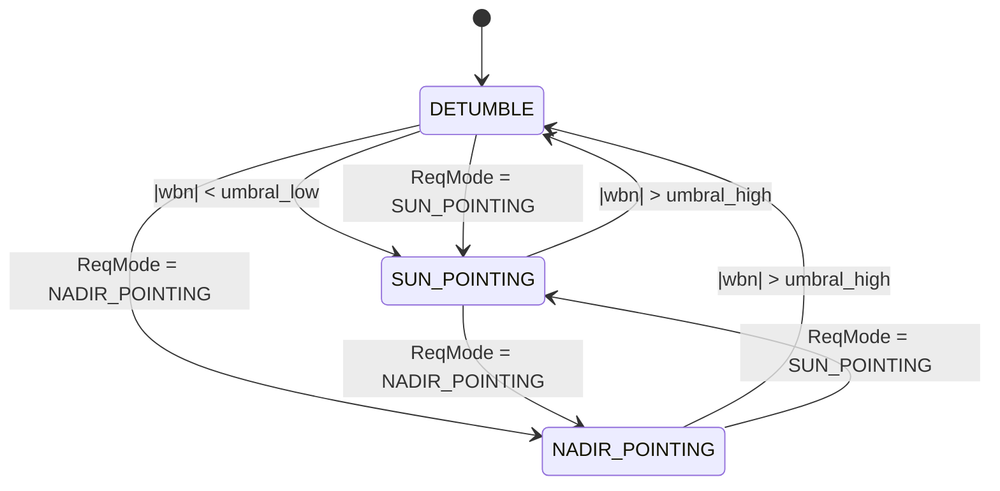

# Máquina de estados del ADCS (`state_machine.c`)

Documentación de la máquina de estados que selecciona el modo de control magnético (MTQ) del FSW en 42: cómo está implementada, cuándo cambia de modo sola y cómo pedirle un cambio de modo desde el command script.

---

## 1. Resumen

| Elemento | Descripción |
|---|---|
| Archivo | `state_machine.c` / `adcs/state_machine.h` |
| Modos | `AC_MODE_DETUMBLE`, `AC_MODE_SUN_POINTING`, `AC_MODE_NADIR_POINTING` |
| Modo inicial | `AC_MODE_DETUMBLE` |
| Estado | Arreglo global `mode[MAX_MODE_ENTRIES]`, indexado por `AC->ID` (`MAX_MODE_ENTRIES = 64`) |
| Entrada externa | `AC->ReqMode` (pedido de cambio de modo, normalmente escrito por el command script) |
| Entrada de decisión | Módulo de la velocidad angular `AC->wbn` y los umbrales de `AcConfig_t` |
| Consumidor | `adcsUBA()` llama a `UpdateMode()` y despacha el algoritmo según `GetCurrentMode()` |

---

## 2. API

```c
void UpdateMode(struct AcType *AC, AcConfig_t *config);
enum AcMode GetCurrentMode(struct AcType *AC);
int  DetumbleDone(struct AcType *AC, AcConfig_t *config);
int  ExitNominal(struct AcType *AC, AcConfig_t *config);
```

- **`UpdateMode`**: se llama una vez por paso de FSW, al principio de `adcsUBA`. Aplica un pedido pendiente (`ReqMode`) o evalúa las transiciones automáticas.
- **`GetCurrentMode`**: devuelve `mode[AC->ID]`. Es lo que usa el `switch` de `adcsUBA` y la columna `fsw_mode` del CSV de comparación.
- **`DetumbleDone`**: `|wbn| < detumble_angular_velocity_threshold_low`.
- **`ExitNominal`**: `|wbn| > detumble_angular_velocity_threshold_high`.

`|wbn|` se calcula con `AC->wbn` (velocidad angular procesada por el FSW).

---

## 3. Diagrama de estados



### Transiciones

| Desde | Hacia | Condición | Origen |
|---|---|---|---|
| `DETUMBLE` | `SUN_POINTING` | `\|wbn\| < detumble_angular_velocity_threshold_low` | Automática |
| `SUN_POINTING` | `DETUMBLE` | `\|wbn\| > detumble_angular_velocity_threshold_high` | Automática |
| `NADIR_POINTING` | `DETUMBLE` | `\|wbn\| > detumble_angular_velocity_threshold_high` | Automática |
| cualquiera | cualquiera | `AC->ReqMode` distinto del modo actual y mayor que 0 | Pedido externo |

- Si el satélite todavía gira rápido, `ExitNominal` lo devuelve a `DETUMBLE` en el paso siguiente.

---

## 4. Qué hace cada modo (`adcsUBA`)

| Modo | Función | Sensores / datos que usa | Notas |
|---|---|---|---|
| `DETUMBLE` | `adcsDetumbling` | `bvb`, `wbn`, EKF | Ley tipo B-dot sobre la velocidad angular |
| `SUN_POINTING` | `adcsSunPointing` | `svb` (CSS), `bvb`, `wbn`, EKF | Usa `SunValid`; en eclipse pasa a ganancias de eclipse |
| `NADIR_POINTING` | `adcsNadirPointing` | `nvb` (horizon sensor), `bvb`, EKF | Espera ver el horizonte por primera vez (`saw_horizon`) |

En `NADIR_POINTING`, antes de que `EarthValid` sea verdadero por primera vez, el control corre solo con el término derivativo. Cuando el sensor ve la Tierra, se guarda `nvb` y se activa el término proporcional. Si el horizonte se pierde después, se sigue usando el último `nvb` guardado.

---

## 5. Cómo cambiar de modo desde el command script

### 5.1 Formato

```
<tiempo> SC[<id>] AC Mode = <MODO>
```

| Campo | Significado |
|---|---|
| `<tiempo>` | `SimTime` de ejecución en segundos |
| `<id>` | Índice del spacecraft (`SC[]`) |
| `<MODO>` | `DETUMBLE`, `SUN_POINTING` o `NADIR_POINTING` (en mayúsculas, exacto) |

### 5.2 Ejemplo de script

```
<<<<<<<<<<<<<<<<<  42:  Command Script File  >>>>>>>>>>>>>>>>>
0.0      SC[0] AC Mode = DETUMBLE
20000.0  SC[0] AC Mode = NADIR_POINTING
EOF
```

### 5.4 Cómo verificar que el cambio ocurrió

- La columna `fsw_mode` de `FswComparison.csv` muestra el modo activo en cada paso. Se grafica en la figura "FSW mode validity and truth passthrough".
- El intérprete imprime por consola cada línea de comando ejecutada. Confirmá que el tiempo coincide con lo esperado.

---
